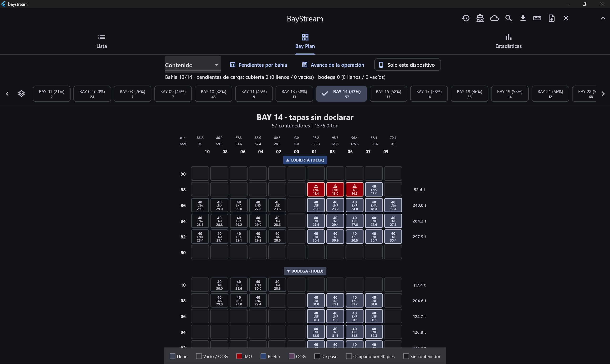
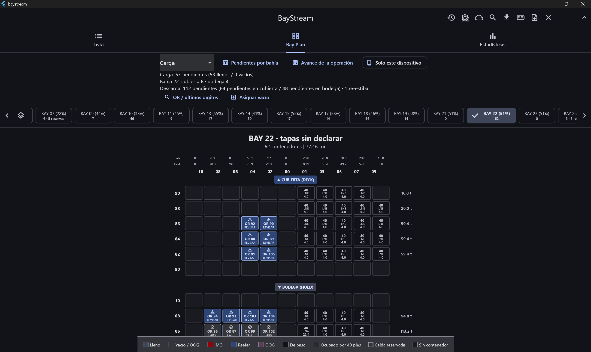
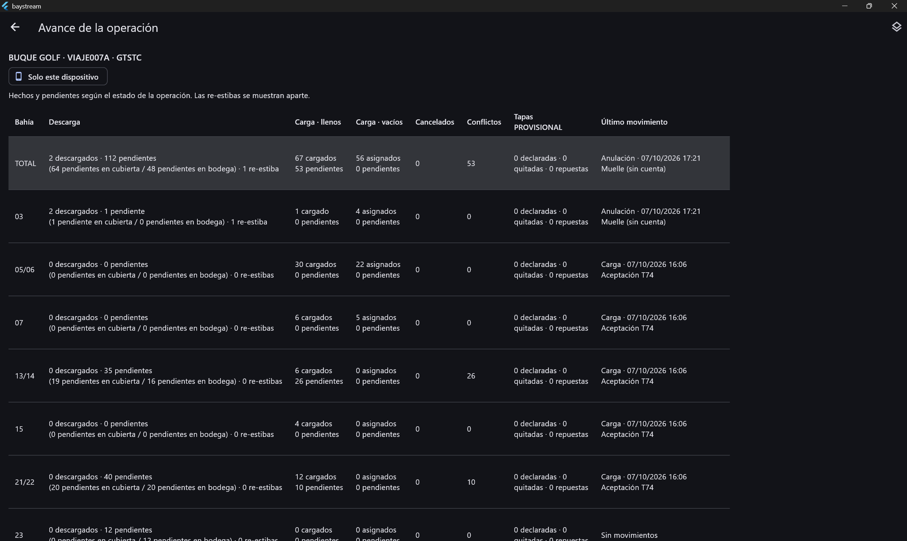
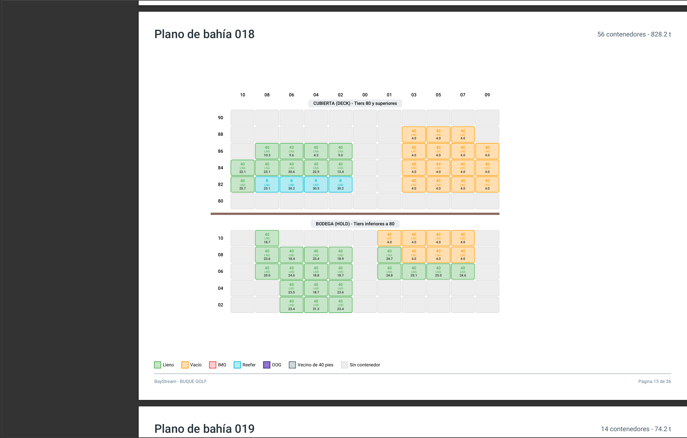

# BayStream

**Planos de estiba de buques portacontenedores, del papel a la pantalla, sincronizados entre el muelle y la oficina.**

BayStream lee los archivos BAPLIE (EDIFACT) con que las líneas navieras describen la carga de un buque. Con ellos dibuja el plano de estiba por bahía y lleva la operación de descarga y carga en tiempo real. Es una aplicación Flutter con una sola base de código para **Windows, Android y Web**.

> El código fuente es privado. Este repositorio presenta el proyecto. El código está disponible bajo solicitud para procesos de selección.

---

## El problema

En muchos puertos de la región, la operación de un buque todavía se lleva en papel:

- el plano de estiba y el listado de carga llegan impresos;
- en el muelle, cada contenedor se marca a mano conforme baja o sube;
- el número de orden se escribe en la celda donde quedó;
- al terminar, la oficina vuelve a digitar todo para generar el BAPLIE de salida.

Eso consume horas y abre la puerta a errores de transcripción. Además, la oficina no ve el avance hasta que el papel vuelve del muelle.

BayStream nace de la experiencia del autor como **Ship Planner** en un puerto de Guatemala, y es su proyecto de graduación de Ingeniería en Sistemas.

## Qué hace

**Lectura y plano**
- Lee BAPLIE de toda la familia 2.x: SMDG 2.0, 2.1 y 2.2. Detecta la versión por la cabecera y rechaza con un mensaje claro lo que no puede leer.
- Dibuja el plano por bahía, en cubierta y bodega. Muestra el peso por celda y por pila, refrigerados, peligrosas (IMO), sobredimensionados y celdas reservadas.
- Valida reglas de estiba en tres estados: conforme, posible incumplimiento y no evaluado.
- Exporta el plano a PDF con el peso en cada celda, como el plano impreso.

**Operación en el muelle**
- Marca en el plano lo que se descarga, con re-estiba y deshacer.
- Confirma los contenedores llenos y asigna los vacíos desde el listado de exportación en Excel, con su número de orden en cada celda.
- Valida antes de confirmar, con un motivo escrito cuando algo no cuadra.
- Registra las tapas de escotilla como movimientos de la operación.
- Busca un contenedor por dictado de voz, por su número completo o por sus últimos dígitos.

**Oficina y sincronización**
- El muelle y la oficina ven el mismo avance en tiempo real.
- Usa cuentas y roles: el muelle pide un cambio y la oficina lo aprueba, mueve o cancela.
- Funciona sin conexión: la cola local de movimientos se sincroniza al volver la red.
- Genera el **BAPLIE de salida** con lo que realmente zarpa, sin volver a digitar nada.

**Uso diario**
- Modo claro, oscuro o el del sistema, y barra plegable para ver más plano.
- La Web arranca sin conexión después de la primera visita: el motor, las fuentes y el SDK se sirven desde el propio sitio.
- En Windows se instala con un paquete MSIX firmado.

## Capturas

<!-- Sube estas imágenes a la carpeta capturas/ de este repositorio con estos nombres exactos. Si alguna no está, borra su línea. -->

| Plano de estiba | Operación en el muelle |
|---|---|
|  |  |

| Avance para la oficina | Plano exportado a PDF |
|---|---|
|  |  |

## Tecnología

| Área | Herramientas |
|---|---|
| Aplicación | Flutter 3.38 y Dart 3.10, para Windows, Android y Web |
| Arquitectura | Clean Architecture (dominio, datos y presentación) y estado con Riverpod |
| Datos locales | Hive CE, con almacén propio por plataforma |
| Nube | Firebase Authentication y Cloud Firestore, con reglas de seguridad por rol |
| Formatos | BAPLIE / UN-EDIFACT (lectura y escritura), Excel (listado de exportación) y PDF |
| Otros | Reconocimiento de voz, instalador MSIX y Firebase Hosting |

```
lib/features/vessel/
├── domain/        entidades y contratos en Dart puro, sin Flutter ni Firebase
├── data/          lector y escritor BAPLIE, almacén local, sincronización con Firestore
└── presentation/  pantallas, widgets y providers de Riverpod
```

## Calidad

- **Más de 650 pruebas automáticas**, y `flutter analyze` en cero.
- **116 pruebas de corpus** sobre archivos BAPLIE reales **anonimizados**. Entre ellos está una escala completa: 398 contenedores de llegada, un plan de carga de 460 posiciones y 176 movimientos de muelle.
- Una batería de pruebas para las **reglas de seguridad** de Firestore.
- **Aceptación cruzada:** cada función se comprueba en los tres clientes (Windows, Android y Web) con las cifras del caso real antes de darse por terminada.
- **Probada en campo** con los archivos de una escala real.
- Ningún dato real entra al repositorio: el corpus vive fuera y está anonimizado.

## Estado

- Publicada en la **Web** y en **prueba interna de Google Play**.
- En desarrollo activo, como proyecto de graduación (2026).
- Próximos pasos: segregación de mercancías peligrosas con el Código IMDG, orden de descarga sugerido y una prueba piloto en una escala real.

## Autor

**Carlos Giovanni Martínez Aldana**
Estudiante de Ingeniería en Sistemas (Universidad Mariano Gálvez de Guatemala) y Ship Planner.
Puerto Barrios, Guatemala · [LinkedIn](https://www.linkedin.com/in/TU-PERFIL)

---

### In English

BayStream turns container-ship stowage plans from paper into a live, shared tool:

- it reads BAPLIE (UN/EDIFACT) files and draws the bay plan;
- it runs discharge and loading operations at the quay;
- it syncs progress with the office in real time, offline-first;
- it generates the outgoing BAPLIE.

It is built with Flutter for Windows, Android and Web, with Clean Architecture, Riverpod, Hive and Firebase. It has more than 650 automated tests and 116 corpus tests on anonymized real files. The source code is private and available on request.
